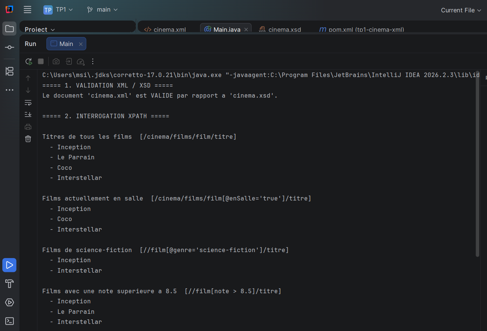
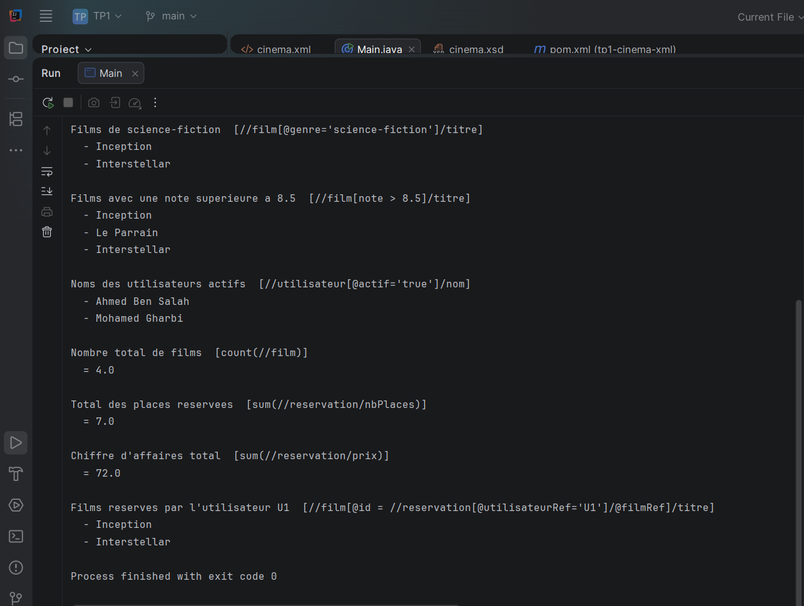

# TP1 : Modélisation XML et interrogation XPath avec Maven en Java

## Informations générales

- **Établissement :** Faculté des Sciences de Sfax
- **Département :** Informatique et Communications
- **Année universitaire :** 2025–2026
- **Filière :** LSI3
- **Matière :** Architecture SOA et services web
- **Enseignantes responsables :** Amel Corine ZAYANI, Hela HAKIM et Rim MOHAMED

## Objectif du TP

Ce TP a pour objectif de modéliser un domaine réel en XML, de définir un schéma XSD pour valider la structure du document XML et de développer une application Java avec Maven permettant de valider les données et de les interroger avec XPath.

## Technologies utilisées

- Java
- Maven
- XML
- XSD
- XPath
- IntelliJ IDEA
- API Java XML : JAXP

## Présentation du projet

Le domaine choisi est celui du **cinéma**. Le document `cinema.xml` représente les informations relatives aux films, aux utilisateurs et aux réservations.

### 1. Modélisation XML

Le document XML contient trois catégories principales :

- **Films :** identifiant, titre, réalisateur, année, durée, note, genre et disponibilité en salle.
- **Utilisateurs :** identifiant, nom, adresse e-mail et état du compte.
- **Réservations :** identifiant, utilisateur concerné, film réservé, date, nombre de places et prix.

Les attributs `utilisateurRef` et `filmRef` permettent d'associer chaque réservation à un utilisateur et à un film.

### 2. Validation XML/XSD

Le fichier `cinema.xsd` définit la structure attendue du document XML, notamment les éléments, leurs types de données et les attributs obligatoires.

La validation est réalisée en Java à l'aide des classes `SchemaFactory`, `Schema` et `Validator`.

Cette étape permet de vérifier que le document XML respecte les règles définies dans le schéma XSD avant d'effectuer les interrogations XPath.

### 3. Interrogation XPath

L'application utilise `XPathFactory` et `XPathExpression` pour extraire des informations du document XML.

Les requêtes implémentées sont les suivantes :

| Fonctionnalité | Requête XPath |
|---|---|
| Afficher tous les titres des films | `/cinema/films/film/titre` |
| Afficher les films actuellement en salle | `/cinema/films/film[@enSalle='true']/titre` |
| Afficher les films de science-fiction | `//film[@genre='science-fiction']/titre` |
| Afficher les films ayant une note supérieure à 8.5 | `//film[note > 8.5]/titre` |
| Afficher les noms des utilisateurs actifs | `//utilisateur[@actif='true']/nom` |
| Compter le nombre total de films | `count(//film)` |
| Calculer le nombre total de places réservées | `sum(//reservation/nbPlaces)` |
| Calculer le chiffre d'affaires total des réservations | `sum(//reservation/prix)` |
| Afficher les films réservés par l'utilisateur U1 | `//film[@id = //reservation[@utilisateurRef='U1']/@filmRef]/titre` |

### 4. Exécution et résultats

La classe principale `Main` exécute les opérations suivantes :

1. Validation du document `cinema.xml` par rapport au schéma `cinema.xsd`.
2. Chargement du document XML.
3. Exécution des requêtes XPath.
4. Affichage des résultats dans la console.

### Résultats d'exécution

Cette capture présente le résultat de la validation du document XML par rapport au schéma XSD, ainsi que les résultats des différentes requêtes XPath exécutées sur les données du cinéma.

## Structure du projet

- `pom.xml` : configuration du projet Maven et de ses dépendances.
- `cinema.xml` : document XML contenant les données du cinéma.
- `cinema.xsd` : schéma décrivant la structure du document XML.
- `Main.java` : classe Java principale contenant la validation XML/XSD et les interrogations XPath.
- `images/` : dossier contenant les captures d'écran des résultats.

## Conclusion

Ce TP permet de mettre en pratique la modélisation de données en XML, la validation d'un document à l'aide d'un schéma XSD et l'extraction d'informations avec XPath en Java. L'utilisation de Maven facilite l'organisation et la gestion du projet.